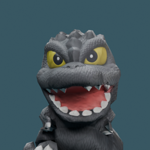

# POPZILLA

**A small macOS daily-task app where getting things done grows a kaiju and reshapes a tiny 3D city.**

A personal SwiftUI + WidgetKit prototype by [yuhengz117-pixel](https://github.com/yuhengz117-pixel), developed with AI assistance. Complete tasks, earn XP, unlock five creature forms, and watch the city react with walking, attacks, and atomic-breath effects.

[Download complete source / test build](https://github.com/yuhengz117-pixel/POPZILLA/releases/latest)



## Features

- Capture daily tasks and split a brain dump into actionable entries.
- Keep up to six tasks in Today, with overflow in Later.
- Completion rewards, XP growth, persistent progress, and undo.
- Five 3D forms and walking, claw, roar, and tail animations.
- A native macOS window, menu-bar panel, and WidgetKit extension.
- Local task storage. Optional planning integrations require the user's own configuration.

The main app embeds a bundled WebKit / Three.js scene, served through a loopback-only asset server. The widget uses a lighter static mascot scene rather than the full 3D renderer.

## Source layout and downloads

The complete Xcode project, Swift source, web scene, textures, five GLB models, tests, and build script are in **POPZILLA-source.zip** under Releases. The large 3D assets are distributed with that archive to keep the repository landing page small.

Selected source files are also available here for quick review:

| File | Responsibility |
| --- | --- |
| `TaskStore.swift` | Shared task state, persistence, XP and rewards |
| `ContentView.swift` | SwiftUI main interface |
| `TaskPlanner.swift` | Task planning implementations |
| `planet.js` | Bundled 3D city and interaction logic |

These review copies are not a standalone Xcode project. Use the full source archive to build.

## Build from complete source

Requires a recent full Xcode installation and macOS 14 or newer. The existing project uses the PopDay target and identifiers for compatibility; the installed product is called POPZILLA.

```sh
unzip POPZILLA-source.zip
cd POPZILLA-source
python3 development/build.py
```

This builds without closing or replacing the installed app. Build output goes to `~/Library/Caches/POPZILLA-Build/`.

For a normal Xcode workflow, open `source/PopDay.xcodeproj`, select the PopDay scheme, and configure your own development team and shared App Group for both the app and widget. Keep the group identifier consistent with the entitlements and task store. App/widget sharing depends on correct signing and provisioning.

The build script has optional `--install` and `--zip` flags; `--install` explicitly closes/replaces the locally installed app. Save any input before using it. No personal task state, API keys, local language-model downloads, or Keychain data are bundled.

## Validation and current limits

The original project records successful app/widget builds and local ad-hoc signature checks. Before publication, the installed app passed a deep strict signature verification. Any newly rerun core checks are documented in the release notes.

This is a personal prototype, not a polished App Store release. The test app is locally signed and is **not Apple-notarized**. Desktop widget placement/taps, live speech recognition, notifications, and external AI service calls have not all been verified. If a downloaded build is blocked by macOS, build it yourself with Xcode; do not disable system protections.

Local mode does not require an API key. Optional external planning modes may send submitted task text to the selected service; never put actual credentials in a public repository.

## Attribution and license

Original app code is under [MIT](LICENSE), with third-party assets excluded from that grant. See [THIRD_PARTY.md](THIRD_PARTY.md).

The Godzilla model originates from **David Wigforss / dwigfor**, licensed **CC BY-NC 4.0**. Bundled variants add scaling, recoloring, dorsal/evolution changes, rigging, and animation. The noncommercial restriction remains applicable to those model assets. Three.js retains its MIT license.

This is an unofficial fan project, not affiliated with or endorsed by the owners of Godzilla. No ownership of the underlying character or third-party model is claimed.

## 中文简介

一个自己做的 macOS 每日任务小 App：完成任务获得 XP，让小怪兽成长并破坏小城市。主窗口用 SwiftUI，三维场景用本地打包的 Three.js，另有菜单栏和 Widget 原型。

完整源码和模型请从 Releases 下载。个人任务、密钥、本机调试记录不在发布包中。Godzilla 模型保留原作者署名及 CC BY-NC 4.0 许可，本项目是非官方同人原型。
